# screendocs

Aponte para um site e receba todas as telas documentadas: uma foto de cada seção de cada página, no computador e no celular, um vídeo rolando a página, uma descrição curta do que cada tela faz e um relatório HTML para abrir ou compartilhar. Páginas que exigem login entram também: você faz login uma vez e o screendocs reaproveita a sessão.

Funciona com qualquer site, em qualquer stack. Nada é instalado no projeto documentado.

[English](README.md) · [Español](README.es.md)

> **Este README é para quem usa o screendocs pelo npm** (`npx screendocs`): como usar, sem baixar nem compilar nada. Para rodar pelo código do GitHub, mudar ou mandar uma correção, veja o [guia para desenvolvedores](CONTRIBUTING.pt-BR.md).

## Começo rápido

**Manual do usuário (npm):** as imagens abaixo vêm do [docs/user-manual.html](docs/user-manual.html), um manual de uma página em inglês, português e espanhol. Baixe e abra no navegador para ver tudo, inclusive cada flag.

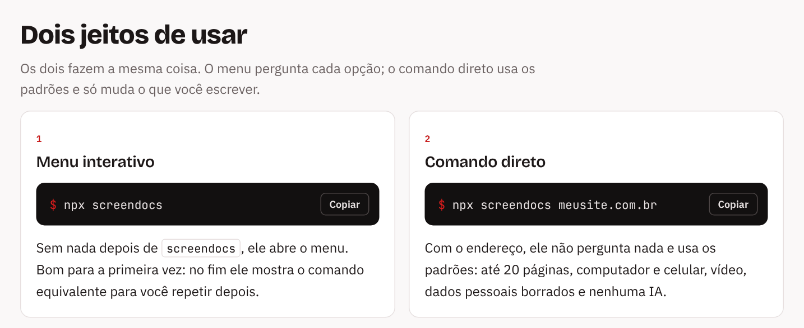

<details>
<summary>O menu, passo a passo</summary>

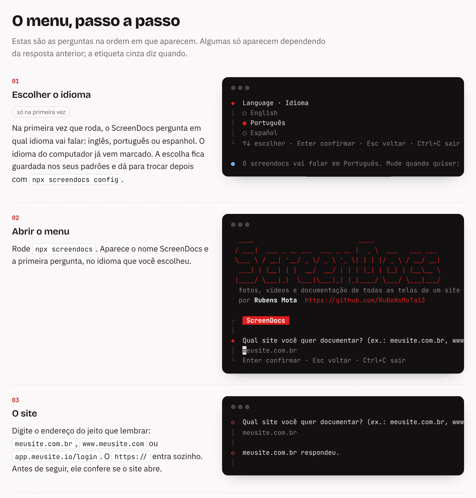

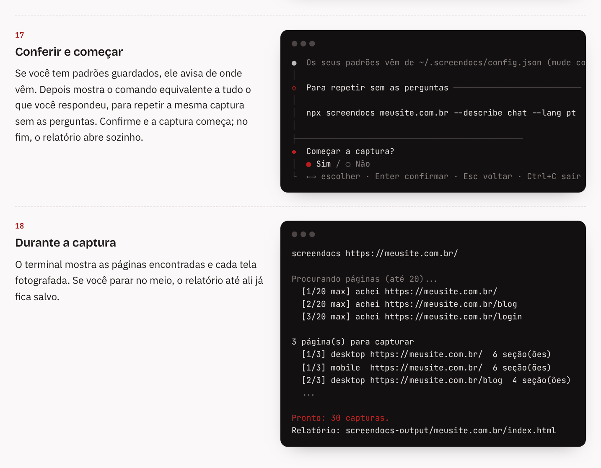

</details>

```bash
npx screendocs
```

Sem argumentos, ele abre um menu interativo que pergunta o site e as opções (login, computador/celular, vídeo, quais páginas) e mostra no fim o comando equivalente. Embaixo de cada pergunta, uma linha mostra o que cada tecla faz: setas para escolher, `Enter` confirma, `Esc` volta para a pergunta anterior e `Ctrl+C` sai. Ou passe tudo de uma vez:

```bash
npx screendocs https://seu-site.com
```

Ele usa o Chrome ou o Edge já instalado no seu computador; nenhum navegador é baixado. O resultado fica em `screendocs-output/<site>/`; abra o `index.html`.

O `npx` baixa e roda a versão mais nova sem instalar nada. Se você usa o screendocs sempre, instale uma vez com `npm install -g screendocs`; aí o comando fica só `screendocs` (por exemplo `screendocs https://seu-site.com`), e rodar a mesma instalação de novo atualiza.

## O que roda por padrão

Com só o link (`npx screendocs meusite.com.br`), ele não pergunta nada e usa os padrões:

| O que | Padrão | Para mudar |
|---|---|---|
| Endereço | confere se abre antes de começar e sugere correções | `--no-url-check` |
| Login | usa o login salvo do site, se existir (`screendocs login`), e avisa se expirou | `npx screendocs login <site>` |
| Páginas | segue os links a partir da página inicial, até 20 páginas e 3 cliques de distância | `--max-pages`, `--depth`, `--exclude`, `--pages` |
| Telas | computador e celular | `--viewports desktop` ou `--viewports mobile` |
| Fotos | uma por seção, mais a página inteira | |
| Vídeo | um rolando cada página | `--no-video` |
| Dados pessoais | borra e-mails, telefones, documentos, cartões e campos preenchidos, e tira esses dados do texto salvo | `--mask`, `--no-auto-mask` |
| Descrições | nenhuma IA: cada tela fica com o texto da página (título e primeiro parágrafo) | `--describe`, ou depois `npx screendocs describe <site>` |
| Idioma das descrições | o idioma do screendocs (perguntado na primeira vez) | `--lang pt` |
| Pasta | `screendocs-output/<site>/` dentro da pasta onde você roda o comando (o terminal mostra o caminho completo no começo), substituindo a captura anterior do mesmo site | `--out`, `--keep` |
| Navegador | escondido | `--headed` |
| Relatório | não abre sozinho; o terminal mostra o caminho do `index.html` | `--open` |

Há quatro jeitos de mudar os padrões:

1. **No comando**, só para essa vez: `npx screendocs meusite.com.br --no-video --describe chat --lang pt --open`. Todas as opções estão em [Opções](#opções) e em `npx screendocs --help`.
2. **Com `npx screendocs config`**, os seus padrões, em qualquer pasta. Veja [Seus padrões e idioma](#seus-padrões-e-idioma).
3. **No arquivo `screendocs.config.json`** (opcional), na pasta onde roda o comando, para valer só ali. Veja [Arquivo de configuração](#arquivo-de-configuração).
4. **Pelo menu** (`npx screendocs` sem link): ele pergunta cada coisa, partindo dos seus padrões, e mostra no fim o comando equivalente, para repetir depois sem as perguntas.

Quando mais de um define a mesma opção, pense em camadas, uma por cima da outra. A de cima ganha:

1. **Os padrões do screendocs** (embaixo): o que vem no pacote, como até 20 páginas.
2. **Os seus padrões**, salvos com `npx screendocs config`: valem em qualquer pasta.
3. **Um `screendocs.config.json` na pasta** (opcional): vale só naquela pasta.
4. **O comando** (em cima): o que você digita agora, só nesta vez.

Por exemplo, com o número de páginas: o screendocs diz 20. Você salvou 40 com `npx screendocs config`, então ele usa 40 em qualquer lugar. A pasta `cliente-x` tem um `screendocs.config.json` que diz 10, então ali ele usa 10. Digitando `--max-pages 5` nessa pasta, ele usa 5, só desta vez.

A maioria só precisa das camadas 2 e 4: salve o que quer sempre com `npx screendocs config` e mude uma vez com uma opção no comando.

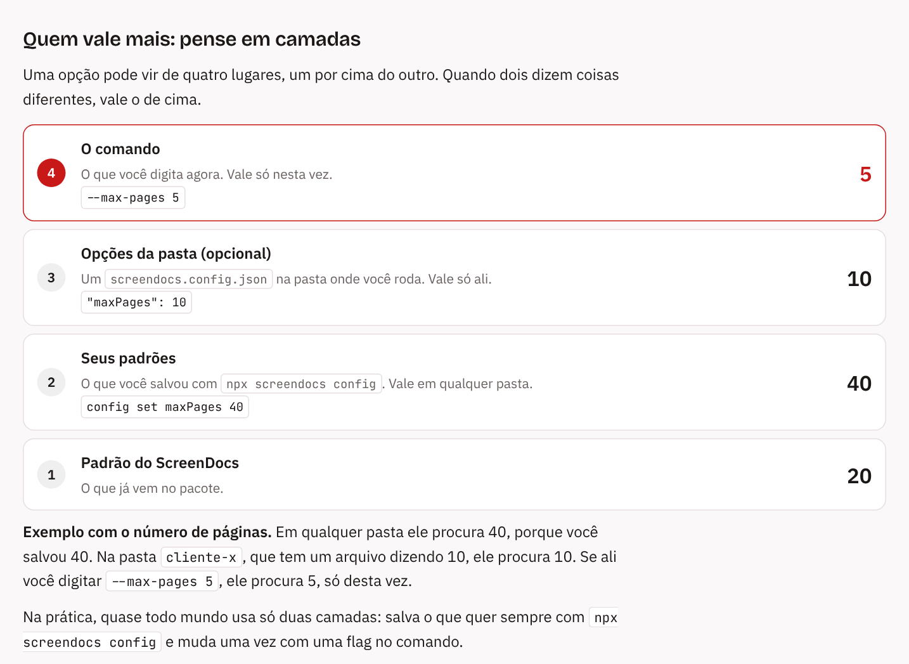

## Páginas com login

```bash
npx screendocs login https://seu-site.com
```

Abre uma janela do navegador. Faça login normalmente (login com Google funciona), volte ao terminal e aperte Enter. A sessão fica salva na sua pasta de usuário, junto dos seus padrões, e as próximas execuções nesse site usam ela, então as páginas que ele encontra depois do login também são fotografadas.

Antes de cada captura ele abre a página em que você estava quando fez login; se o site mandar para outro lugar ou pedir senha, ele avisa que o login expirou (o menu oferece fazer login de novo).

Como fica na sua pasta de usuário, o login vale em qualquer pasta onde você rodar o screendocs. A sessão salva dá acesso à sua conta, por isso só o seu usuário consegue ler. Ela não é criptografada: quem copiar o arquivo, ou usar a sua conta neste computador, entra no site como você, então nunca mande esse arquivo para ninguém. Para sair de um site, rode `npx screendocs login` de novo ou saia da conta pelo próprio site.

## O que ele faz

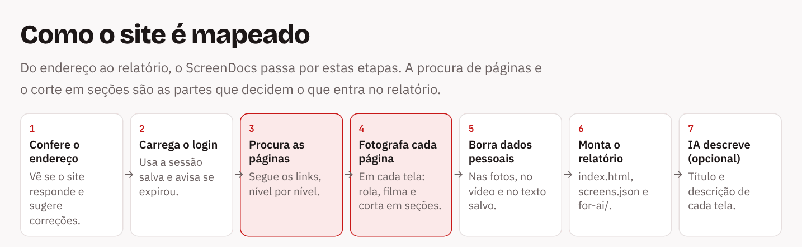

<details>
<summary>Como as páginas e as seções são encontradas</summary>

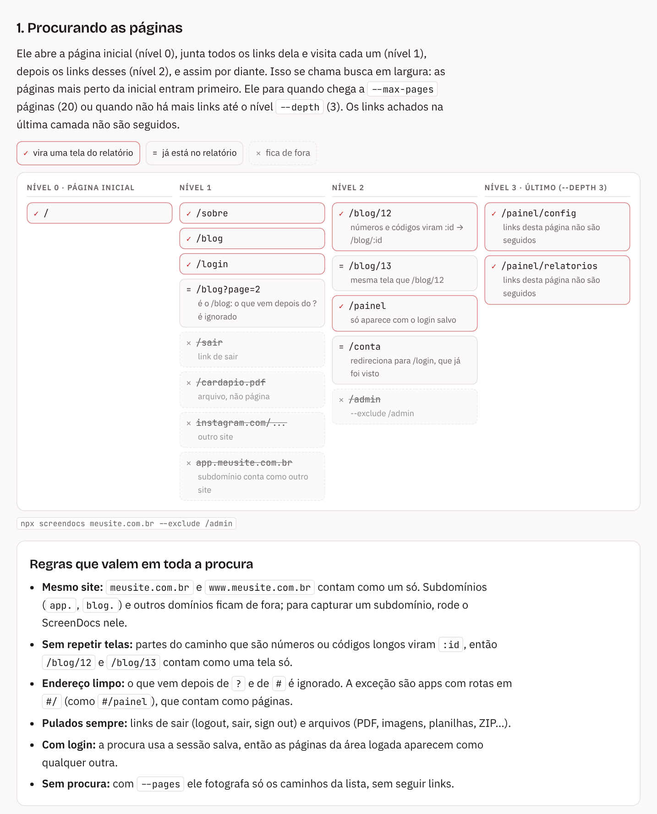

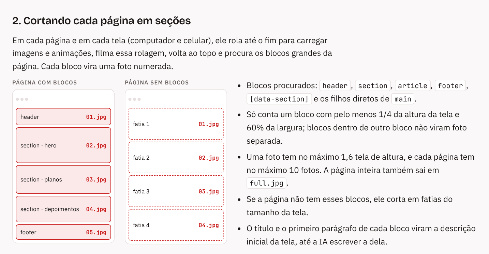

</details>

- **Confere o endereço** antes de começar: se o site não abrir, testa endereços parecidos (com ou sem `www.`, outros finais como `.com.br`, `.com`, `.net`, `.org`, `.io`, `.app`, `.dev`, erros como `.con`) e sugere os que abrirem, com exemplos como `meusite.com.br`, `meusite.app` ou `app.meusite.io/login`.
- **Acha as páginas sozinho**: segue os links do próprio site a partir da página inicial, pula links de sair/logout e arquivos, e trata `/posts/12` e `/posts/13` como uma tela só.
- **Uma imagem por seção**: `<header>`, `<section>`, `<footer>` e blocos parecidos; páginas sem isso são cortadas em fatias do tamanho da tela. Também tira a página inteira.
- **Computador e celular** (1440×900 e 390×844).
- **Vídeo** de cada página rolando.
- **Esconde dados pessoais**: ficam borrados nas fotos e nos vídeos e viram `•••` no texto salvo com a captura (`screens.json`, o relatório e o texto enviado à IA):
  - e-mails, números de cartão (conferidos pelo dígito verificador) e telefones nos formatos do Brasil, EUA, Espanha e internacional (`+código`);
  - documentos: CPF e CNPJ (com ou sem pontuação), SSN (EUA), DNI e NIE (Espanha), DNI (Argentina), CURP e RFC (México), IBAN;
  - campos de e-mail, telefone e senha preenchidos, e qualquer campo com um dos dados acima.

  Adicione seus próprios seletores CSS com `--mask` (que também ficam fora do texto salvo). Nomes e texto livre não são detectados: use uma conta de teste quando puder.
- **Descrições**: por padrão, o título e o primeiro parágrafo de cada seção. Uma IA pode olhar cada foto e escrever um título e uma descrição: veja [Descrições com qualquer IA](#descrições-com-qualquer-ia).
- **Relatório**: `index.html` com todas as páginas, as duas telas e os vídeos, mais o `screens.json` para usar em scripts.

## Opções

| Opção | Padrão | |
|---|---|---|
| `--max-pages <n>` | 20 | quantas páginas procurar |
| `--depth <n>` | 3 | profundidade de links a partir da inicial |
| `--pages /a,/b` | | fotografa exatamente esses caminhos em vez de procurar |
| `--exclude a,b` | | pula URLs que contêm esses textos |
| `--viewports <lista>` | `desktop,mobile` | `desktop` (computador), `mobile` (celular) ou os dois |
| `--no-video` | | sem vídeos |
| `--out <pasta>` | `screendocs-output` | pasta de saída |
| `--keep` | | guarda a captura anterior do site (renomeada com a data) em vez de substituir |
| `--mask <seletores>` | | seletores CSS extras para borrar |
| `--no-auto-mask` | | não borra e-mails, telefones, documentos |
| `--describe <como>` | | quem escreve as descrições: `claude`, `codex`, `antigravity` ou `chat` (veja abaixo). `none`: sem IA só nesta vez, para quando os seus padrões têm uma IA e você roda direto pelo comando (no menu, escolha "Por enquanto, só o scan da página") |
| `--model <provedor/modelo>` | | descreve com uma API (ex.: `gemini/gemini-2.5-flash`, `ollama/llama3.2-vision`; veja abaixo) |
| `--instructions <texto>` | | o que mais as descrições devem levar em conta, ex.: `"fale do que o cliente ganha"` |
| `--docs <caminho>` | | documentação do projeto para a IA ler: uma pasta ou um arquivo (veja [Pedido extra e documentação](#pedido-extra-e-documentação)) |
| `--lang <código>` | o idioma do screendocs | idioma das descrições (`pt`, `en`, `es`...) |
| `--config <arquivo>` | `screendocs.config.json` | arquivo de configuração (veja abaixo) |
| `--headed` | | mostra o navegador |
| `--no-url-check` | | não confere se o endereço abre (sites que só abrem na sua rede ou VPN) |
| `--open` | | abre o relatório no fim (o menu sempre abre) |
| `-v`, `--version` | | mostra a versão |
| `-h`, `--help` | | mostra a ajuda |

Variáveis de ambiente:

| Variável | |
|---|---|
| `OPENAI_API_KEY`, `GEMINI_API_KEY`, `ANTHROPIC_API_KEY`, `OPENROUTER_API_KEY` | a chave do provedor para `--model` |
| `SCREENDOCS_API_KEY` | uma chave para `--model`, qualquer que seja o provedor |
| `OPENAI_BASE_URL` | outro servidor compatível com OpenAI, com `--model openai/<modelo>` |
| `OLLAMA_HOST` | onde o Ollama roda, quando não é `localhost:11434` |
| `CHROMIUM_PATH` | usa outro navegador baseado em Chromium no lugar do Chrome ou Edge |
| `SCREENDOCS_DEBUG` | defina como `1` para ver o erro completo |
| `SCREENDOCS_LANGUAGE` | o idioma do screendocs nesta execução: `en`, `pt` ou `es` |
| `SCREENDOCS_HOME` | outra pasta para os seus padrões e chaves salvas (padrão `~/.screendocs`) |

## Seus padrões e idioma

O screendocs fala inglês, português ou espanhol. Na primeira vez que roda num terminal ele pergunta qual (já vem marcado o idioma do computador) e guarda a resposta.

Os seus padrões ficam salvos no seu computador, na sua pasta de usuário (`npx screendocs config path` mostra onde), e não na pasta onde você roda o comando. Eles valem em qualquer pasta e continuam lá quando o screendocs atualiza. Uma opção digitada no comando, ou um `screendocs.config.json` na pasta, ainda ganham deles.

```bash
npx screendocs config                         # menu: escolha uma opção, mude, Pronto
npx screendocs config list                    # o que está guardado
npx screendocs config set language pt         # en, pt ou es
npx screendocs config set max-pages 30
npx screendocs config set viewports desktop
npx screendocs config set video false
npx screendocs config set describe claude     # ou: config set model gemini/gemini-2.5-flash
npx screendocs config unset video             # volta ao padrão
npx screendocs config reset                   # apaga tudo (o idioma é perguntado de novo)
npx screendocs config path                    # onde fica o arquivo
```

As opções têm os mesmos nomes do `screendocs.config.json` (`maxPages` ou `max-pages`, tanto faz), mais `language`.

## Arquivo de configuração

Opcional, para quando um projeto precisa de opções diferentes dos seus padrões. Crie um arquivo chamado `screendocs.config.json` na pasta onde você roda o comando para esse projeto, com as opções dele. Elas valem sempre que você roda o screendocs nessa pasta, e uma opção digitada no comando ainda vale mais que o arquivo. Ninguém precisa criar esse arquivo: sem ele, valem os seus padrões.

```json
{
  "maxPages": 30,
  "exclude": ["/admin", "/blog/"],
  "viewports": ["desktop", "mobile"],
  "mask": [".nome-cliente", "#saldo"],
  "describe": "claude",
  "docs": "./docs",
  "instructions": "fale do que o cliente ganha em cada tela",
  "lang": "pt"
}
```

## Resultado

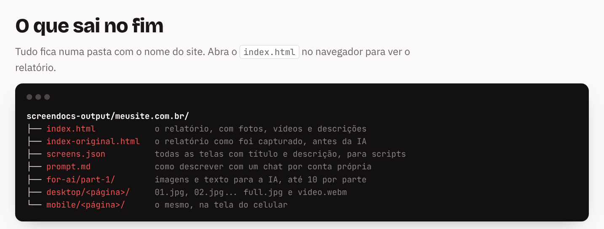

```
screendocs-output/seu-site.com/
  index.html          relatório
  index-original.html o relatório como foi capturado, antes de qualquer descrição da IA (nunca é reescrito)
  screens.json        todas as páginas e telas com título e descrição
  screens-original.json  o mesmo, como foi capturado
  prompt.md           como descrever as telas com um chat de IA por conta própria
  docs-for-ai.md      o texto tirado da documentação (só com --docs)
  for-ai/part-1/...   as telas a descrever, com nomes únicos, e o texto para a IA
  desktop/<pagina>/01.jpg, 02.jpg ... full.jpg, video.webm
  mobile/<pagina>/...
```

## Descrições com qualquer IA

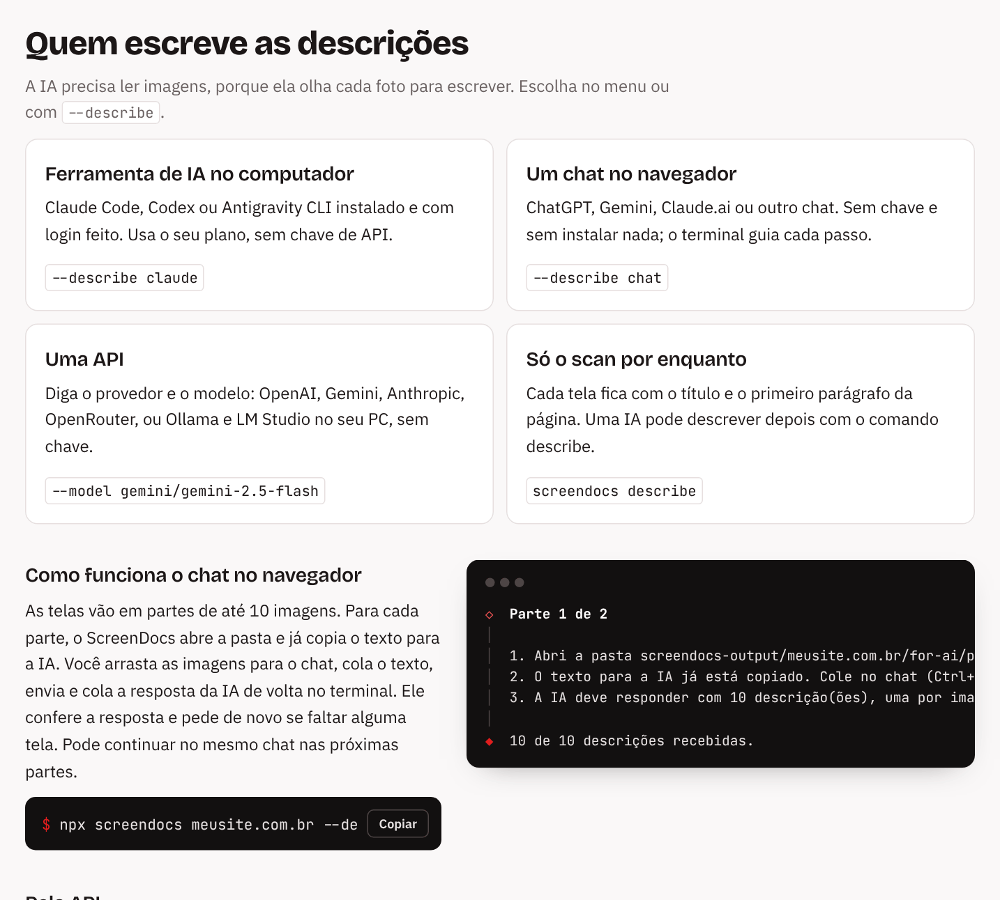

Escolha quem escreve as descrições no menu ("Quem escreve as descrições das telas?") ou com `--describe`. Para descrever uma captura que você já fez, sem capturar de novo:

```bash
npx screendocs describe seu-site.com.br
```

Sem o site (ou com um site que não tem captura), ele lista as capturas que existem para você escolher.

Os títulos e descrições vão para o `screens.json` e o `index.html`, e as telas do celular reaproveitam a descrição da mesma seção no computador. O relatório marca em cada tela quem a descreveu (por exemplo "Claude Code" ou "AI chat"), ou "page text" quando nenhuma IA descreveu, e o terminal lista as telas que ficaram de fora. O que a IA mudou fica visível: cada tela descrita tem uma linha "Before AI" com o texto que tinha antes, e o `index-original.html` guarda o relatório inteiro como foi capturado, sem nunca ser reescrito. Use `--lang pt` (ou o menu) para descrições em português.

> A IA precisa **ler imagens**: ela olha cada captura para escrever a descrição. Um modelo que só lê texto não consegue.

**1. Um chat no navegador (sem chave, sem instalar nada).** Escolha "Um chat no navegador (ChatGPT, Gemini, Claude.ai...)" ou use `--describe chat`. O screendocs guia você: abre uma pasta com as imagens (até 10 por parte, com nomes únicos) e copia o texto para a IA; você arrasta as imagens para o chat, cola o texto e cola a resposta da IA de volta no terminal. Quando uma parte termina, ele fecha a janela daquela pasta (Windows e macOS). Ele confere a resposta e pede de novo se não vier certa. O `prompt.md` explica como fazer a parte do chat por conta própria.

**2. Uma ferramenta de IA no seu computador (usa o seu plano, sem chave de API).** Se o [Claude Code](https://code.claude.com), o [Codex](https://developers.openai.com/codex) ou o [Antigravity CLI](https://antigravity.google) (`agy`, use uma versão recente) estiver instalado e com login feito, o screendocs roda ele para você. O menu sempre mostra os três; se o escolhido não estiver instalado, ele oferece instalar com o instalador oficial e diz como fazer login:

```bash
npx screendocs https://seu-site.com.br --describe claude   # ou codex, antigravity
```

**3. Qualquer API (para devs).** Diga o modelo com o provedor na frente, o formato comum das ferramentas de IA (LiteLLM, aider); ele é chamado direto, sem instalar SDK:

```bash
npx screendocs seu-site.com.br --model gemini/gemini-2.5-flash
```

| Modelo | Provedor | Chave |
|---|---|---|
| `openai/gpt-4o-mini` | OpenAI | `OPENAI_API_KEY` |
| `gemini/gemini-2.5-flash` | Google Gemini | `GEMINI_API_KEY` |
| `anthropic/claude-sonnet-4-5` | Anthropic | `ANTHROPIC_API_KEY` |
| `openrouter/<modelo>` | OpenRouter | `OPENROUTER_API_KEY` |
| `ollama/<modelo>` | Ollama no seu computador (grátis) | nenhuma |
| `lmstudio/<modelo>` | LM Studio no seu computador (grátis) | nenhuma |

Para OpenAI, Gemini e Anthropic o prefixo pode ficar de fora (`--model gemini-2.5-flash` também funciona), porque o nome já diz o provedor.

**A chave** é procurada nesta ordem: a variável do provedor acima (se você já usa outra ferramenta de IA, provavelmente ela já existe), `SCREENDOCS_API_KEY` e a chave guardada com `npx screendocs keys set <provedor>`. Se não achar nenhuma, o screendocs pede a chave sem mostrar o que você digita e pergunta se deve guardá-la (já vem marcado Não, então por padrão ela vale só para aquela execução).

A chave é testada com o provedor antes de a captura começar. Se você digitar errado, ele pede de novo na hora. Se uma chave guardada ou a de uma variável for recusada (expirou ou foi trocada), o screendocs diz qual foi e, num terminal, pede a nova e oferece trocar a guardada.

Uma chave guardada vai para o lugar seguro do próprio sistema: o Keychain no macOS, criptografada com a sua conta do Windows no Windows (só você, neste computador, consegue ler), ou o chaveiro do Linux (`secret-tool`). Quando nenhum existe, ela fica em `~/.screendocs/keys.json`, que só o seu usuário pode ler. Nos dois casos ela fica na sua pasta de usuário, fora de qualquer projeto, então nunca vai para o Git. `npx screendocs keys list` mostra quais provedores têm chave guardada e onde, e `keys remove <provedor>` apaga uma. Uma chave guardada por uma versão anterior continua no arquivo até você guardá-la de novo com `keys set`.

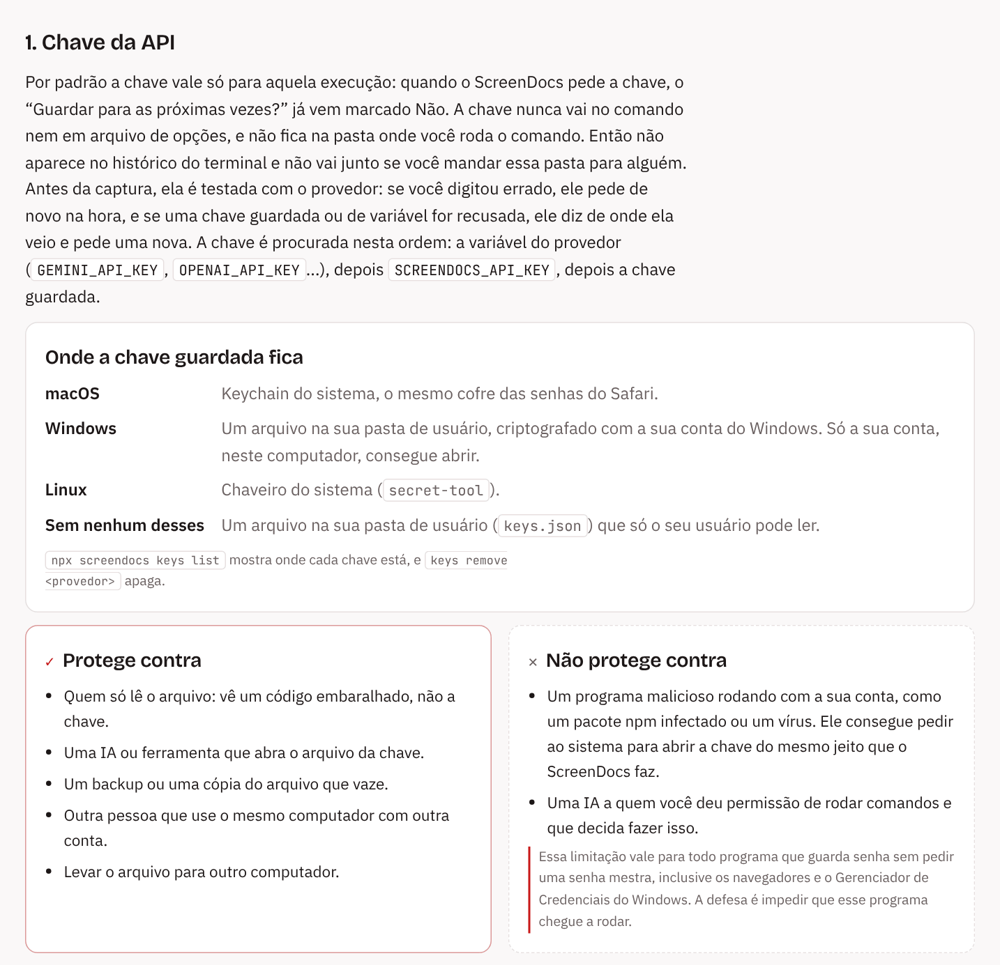

**Modelos locais** (Ollama, LM Studio) não precisam de chave. Antes de capturar, o screendocs confere se o servidor responde e, no Ollama, se o modelo foi baixado (se não foi, mostra o comando `ollama pull`). Se o Ollama roda em outro endereço, defina `OLLAMA_HOST`. O modelo precisa ler imagens (ex.: `llama3.2-vision`, `qwen2.5vl`, `llava`, `gemma3`) e precisa de um computador com memória suficiente.

Para outro servidor compatível com OpenAI, faça como as ferramentas da OpenAI: defina `OPENAI_BASE_URL` com o endereço dele e use `--model openai/<modelo>`.

Escolha um modelo que leia imagens; se escolher um que não lê, o screendocs avisa. O menu pergunta o provedor e o modelo, usa a chave guardada quando houver e nunca mostra a chave.

O screendocs manda até 10 telas por pedido, então a documentação vai poucas vezes e a conta sai menor. As telas que um pedido deixar de fora (ou todas, se o modelo só aceitar uma imagem por vez) são pedidas de novo uma a uma.

### Pedido extra e documentação

Todos os jeitos de descrever (chat, Claude Code, Codex, Antigravity, API e MCP) recebem o mesmo texto com as regras. Depois de escolher quem descreve, o menu faz duas perguntas opcionais, e Enter pula cada uma:

- **"Quer que as descrições falem de algo específico?"**: o que você digitar vai junto para a IA, por exemplo *"fale do que o cliente ganha em cada tela"*. No comando: `--instructions "..."`.
- **"Tem uma pasta ou arquivo com documentação do site para a IA ler?"**: um manual, um README, as notas do projeto. No comando: `--docs <caminho>`.

A documentação pode ser uma pasta (com subpastas) ou um arquivo só, em `.md`, `.mdx`, `.txt`, `.html`, `.rst`, `.adoc`, `.json`, `.yaml`, `.csv`, PDF, Word (`.docx`), Excel (`.xlsx`), PowerPoint (`.pptx`) e OpenDocument (`.odt`, `.ods`, `.odp`). O screendocs não resume nada: tira o texto, guarda em `docs-for-ai.md` na pasta da captura e manda inteiro para a IA, até uns 150 KB (cerca de 40 páginas); o que passar disso é cortado. PDF escaneado (só imagem) não tem texto e fica de fora.

Os dois ficam salvos com a captura, então um `npx screendocs describe <site>` depois usa os mesmos. Para trocar, passe outro valor; para tirar, passe vazio (`--instructions ""`, `--docs ""`).

## Usar por uma IA (MCP)

`screendocs mcp` transforma o screendocs em ferramentas para clientes de IA que falam [MCP](https://modelcontextprotocol.io) (Claude Code, Cursor, VS Code, Claude Desktop, Codex...). Você pede com suas palavras, por exemplo *"documente as telas de meusite.com.br em português"*, e a IA captura o site, olha cada foto e escreve as descrições ela mesma, pelo seu plano, sem chave de API.

**Claude Desktop (um clique).** Baixe o [screendocs.mcpb](https://github.com/RuBeNsMoTa13/screendocs/releases/latest/download/screendocs.mcpb) e abra: o Claude Desktop mostra um botão Instalar e pergunta em qual pasta ficam as capturas. Não precisa instalar mais nada; o Claude Desktop traz o próprio Node.js.

**Claude Code**

```bash
claude mcp add screendocs -- npx -y screendocs mcp
# Windows:
claude mcp add screendocs -- cmd /c npx -y screendocs mcp
```

Com `--scope user` ele fica disponível em todos os projetos. Confira com `/mcp` dentro do Claude Code.

**Cursor** (`.cursor/mcp.json`), Claude Desktop sem o instalador (`claude_desktop_config.json`) e a maioria dos outros clientes:

```json
{
  "mcpServers": {
    "screendocs": { "command": "npx", "args": ["-y", "screendocs", "mcp", "--dir", "C:/Users/voce/screendocs"] }
  }
}
```

**VS Code** (`.vscode/mcp.json`): o mesmo, dentro de `"servers"` e com `"type": "stdio"`. **Codex** (`~/.codex/config.toml`):

```toml
[mcp_servers.screendocs]
command = "npx"
args = ["-y", "screendocs", "mcp"]
```

As capturas ficam na pasta em que o cliente inicia o servidor (no Claude Code e no Cursor, o seu projeto). `--dir <pasta>` escolhe essa pasta, o que vale a pena no Claude Desktop, onde ela não é sua (o instalador pergunta). Os logins salvos ficam na sua pasta de usuário, igual no terminal. Para usar uma cópia do screendocs que não está no npm, troque `npx -y screendocs` por `node <caminho>/bin/screendocs.mjs`.

| Ferramenta | O que faz |
|---|---|
| `capture_site` | Captura um site (mesmas opções da linha de comando: `pages`, `exclude`, `viewports`, `maxPages`, `depth`, `video`, `keep`, `mask`, `lang`, `instructions`, `docs`...) |
| `list_captures` | Os sites já capturados |
| `get_capture` | As telas de uma captura, com o caminho de cada imagem, a descrição atual e o mesmo texto com as regras que os outros modos recebem (aceita `instructions` e `docs`) |
| `view_screens` | Mostra até 10 fotos para a IA |
| `save_descriptions` | Salva títulos e descrições no `screens.json` e no relatório, marcados com o nome da IA |
| `login`, `save_login` | Abre uma janela do navegador para você fazer login e depois salva a sessão para as próximas capturas |

Uma captura leva de um a vários minutos; com `video: false` é mais rápida.

> **Quais IAs funcionam.** Qualquer app que roda servidores MCP no seu computador: Claude Desktop, Claude Code, Cursor, VS Code (Copilot), Windsurf, Codex, Gemini CLI, Cline, LM Studio e outros. Chats de IA que rodam só no navegador (ChatGPT, Claude.ai, Gemini na web) não conseguem abrir um programa no seu computador, então não funcionam. O modelo também precisa **ler imagens**: ele olha cada foto para descrevê-la. Um modelo só de texto consegue capturar o site, mas não descrever as telas.

## O que fica no seu computador

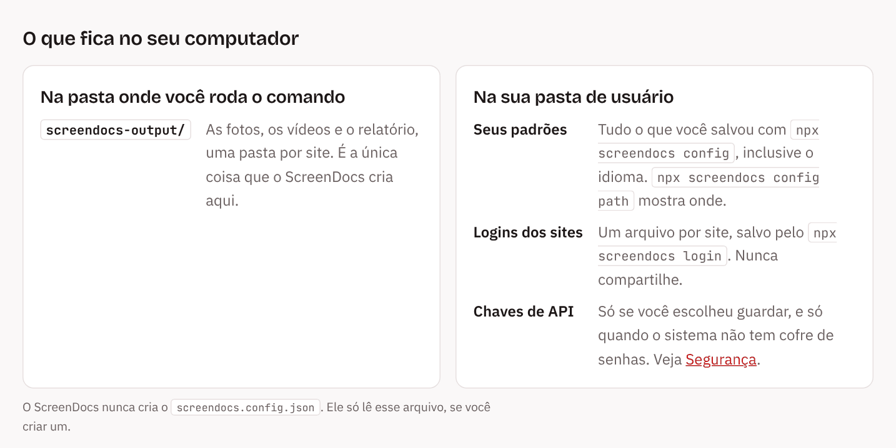

Na pasta onde você roda o comando, só a `screendocs-output/`: as capturas e os relatórios, uma pasta por site. Todo o resto fica na sua pasta de usuário (`npx screendocs config path` mostra onde):

| O quê | |
|---|---|
| Seus padrões | o que você salvou com `npx screendocs config`, inclusive o idioma |
| Logins dos sites | um arquivo por site, salvo pelo `npx screendocs login`. Não é criptografado; nunca compartilhe |
| Chaves de API | só se você escolheu guardar, e só quando o sistema não tem cofre de senhas |

Apagar essa pasta apaga os três: você faz login nos sites de novo, e o idioma é perguntado de novo na próxima vez.

Um `screendocs.config.json` só é lido, se você criou um; o screendocs nunca cria esse arquivo.

## Dados reais

Áreas logadas costumam mostrar dados de pessoas reais. O borrão automático cobre os casos comuns, não todos: use uma conta de teste quando puder e confira as imagens antes de publicar.

## Requisitos

Node.js 18 ou mais novo. Google Chrome ou Microsoft Edge instalado (o Edge já vem no Windows). Para usar outro navegador baseado em Chromium, aponte `CHROMIUM_PATH` para o executável dele.

## Rodar pelo código

Para baixar o código do GitHub e rodar, mudar ou mandar uma correção, veja o [CONTRIBUTING.pt-BR.md](CONTRIBUTING.pt-BR.md).

## Licença

MIT
